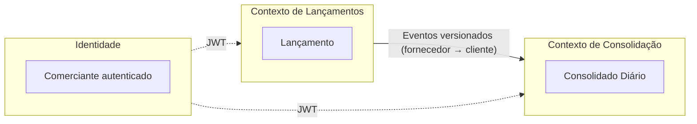

# 1. Domínios funcionais e capacidades de negócio

## Problema
Um comerciante precisa registrar débitos e créditos do dia a dia e consultar o saldo diário consolidado. O registro é crítico: uma venda ou pagamento não registrado é informação perdida. O relatório é importante, mas pode ser reconstruído e tolera atraso curto.

Essa diferença de criticidade é o principal direcionador da arquitetura.

## Cadeia de valor


## Mapa de capacidades
| Domínio | Tipo | Capacidade | Criticidade |
|---|---|---|---|
| Lançamentos | Core | Registrar débito e crédito | Alta |
| Lançamentos | Core | Estornar lançamento | Alta |
| Lançamentos | Core | Consultar lançamentos | Média |
| Lançamentos | Core | Publicar fatos de negócio | Alta |
| Consolidação | Core | Consolidar movimentos por dia | Média |
| Consolidação | Core | Consultar saldo diário | Média, com pico de 50 req/s |
| Consolidação | Core | Reprocessar o consolidado | Média |
| Identidade e acesso | Genérico | Autenticar e autorizar | Alta (comprar, não construir) |
| Observabilidade | Suporte | Métricas, logs, traces e alertas | Alta |

## Contextos delimitados


- **Lançamentos** é a fonte da verdade e não conhece o Consolidado.
- **Consolidação** mantém uma visão derivada, que pode ser reconstruída a partir dos lançamentos.
- O contrato entre os dois é o evento publicado, nunca o banco de dados do outro serviço.

## Linguagem ubíqua
| Termo | Definição |
|---|---|
| Comerciante | Dono do fluxo de caixa e fronteira de isolamento dos dados |
| Lançamento | Registro imutável de um crédito ou débito |
| Data de competência | Dia, no fuso do comerciante, ao qual o lançamento pertence |
| Estorno | Novo lançamento de sentido inverso que anula um lançamento anterior |
| Saldo do dia | Total de créditos menos total de débitos do dia |
| Saldo acumulado | Soma dos saldos do dia até a data consultada |

## Eventos de domínio
| Evento | Produtor | Consumidor | Efeito |
|---|---|---|---|
| `LancamentoRegistrado` | Lançamentos | Consolidação | Soma crédito ou débito no dia de competência |
| `LancamentoEstornado` | Lançamentos | Consolidação | Soma o movimento inverso no dia de competência do estorno |

Exemplo de contrato:
```json
{
  "eventId": "0192f0a1-7c3e-7b52-9a10-3f1c2d4e5a6b",
  "eventType": "LancamentoRegistrado",
  "schemaVersion": 1,
  "occurredAt": "2026-11-03T14:30:00Z",
  "comercianteId": "c-123",
  "lancamentoId": "0192f0a1-7c3d-7000-8000-000000000001",
  "tipo": "CREDITO",
  "valorCentavos": 15000,
  "moeda": "BRL",
  "dataCompetencia": "2026-11-03"
}
```

## Fora do escopo
Múltiplas moedas, conciliação bancária, integração com adquirentes, contabilidade formal e cadastro de comerciantes.
